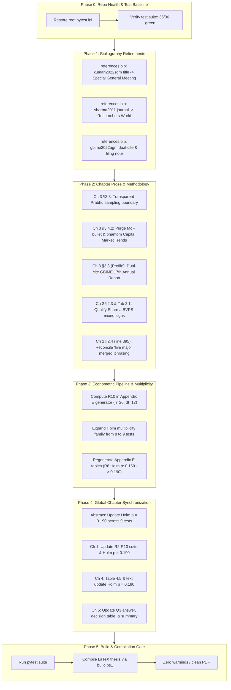

# Surgical Implementation Plan: Thesis Issue Remediation (v2 Final)

> **Historical plan; superseded.** Do not apply its proposed patches as current instructions. Use `issues/v2/final_reconciliation_record.md` for current dispositions. In particular, retain the thesis bibliography's `Journal of Arts, Science and Commerce` title for Sharma; the proposed `Researchers World` replacement below is not the adopted citation.

**Target Scope:** Resolution of all seven audited issues (I-01 through I-07) and repository health restoration.  
**Guiding Principle:** Surgical, minimal-diff edits preserving verified facts, complete econometric reproducibility, and zero hallucinated justifications.

---

## Architecture of the Changes



---

## Phase 0: Repository Health & Baseline Gate (COMPLETED)
- [x] **Restore Root `pytest.ini`:**
  - File: `pytest.ini`
  - Restored configuration pointing to `data_analysis/analysis/tests` and `data_analysis/data_extract/tests`.
  - Executed `python -m pytest`: **All 36 tests passed in 33.49s**. Baseline test gate is fully operational.

---

## Phase 1: Bibliography Refinements (`src/thesis/references.bib`)

### 1.1 `kumari2022sgm` (Issue I-03)
* **File:** `src/thesis/references.bib` (lines 296–302)
* **Current Text:**
  ```bibtex
  @misc{kumari2022sgm,
    author       = {{Kumari Bank Limited}},
    title        = {Extraordinary general meeting document, FY 2079/80 (merger proposals and share swap ratio)},
    year         = {2022},
    howpublished = {Official bank filing},
    url          = {https://backend.kumaribank.com/storage/agm-report/2022/12/1670847430_Extra_Ordinary_General_Meeting_2079-08-25_Kumari_Bank_Ltd..pdf}
  }
  ```
* **Surgical Replacement:**
  ```bibtex
  @misc{kumari2022sgm,
    author       = {{Kumari Bank Limited}},
    title        = {Minutes of the Special General Meeting of {Kumari Bank Limited} held on 2079/08/25},
    year         = {2022},
    howpublished = {Official corporate disclosure},
    url          = {https://backend.kumaribank.com/storage/agm-report/2022/12/1670847430_Extra_Ordinary_General_Meeting_2079-08-25_Kumari_Bank_Ltd..pdf},
    note         = {Approved final merger agreement with Nepal Credit and Commerce Bank Limited and 1:1 share swap ratio; meeting convened 25 Mangsir 2079 BS (11 December 2022)}
  }
  ```

### 1.2 `sharma2011` (Issue I-06)
> **Superseded:** Do not apply the journal-title replacement below. The current thesis bibliography retains *Journal of Arts, Science and Commerce*; see `issues/v2/final_reconciliation_record.md` for the reconciled disposition. The author-name change to `Sharma, Sanjeet` is already present.
* **File:** `src/thesis/references.bib` (lines 11–19)
* **Surgical Replacement:** Expand journal title to its full indexed registered name, and add author's full forename:
  ```bibtex
  @article{sharma2011,
    author  = {Sharma, Sanjeet},
    title   = {Determinants of equity share prices in India},
    journal = {Researchers World: Journal of Arts, Science and Commerce},
    volume  = {2},
    number  = {4},
    pages   = {51--60},
    year    = {2011}
  }
  ```

### 1.3 `gbime2022agm` (Issue I-07)
* **File:** `src/thesis/references.bib` (lines 281–287)
* **Surgical Replacement:**
  ```bibtex
  @misc{gbime2022agm,
    author       = {{Global IME Bank Limited}},
    title        = {Minutes of the 16th Annual General Meeting},
    year         = {2022},
    howpublished = {Corporate disclosure filed with Nepal Stock Exchange; confirmed in 17th Annual Report},
    url          = {https://www.nepalstock.com.np/api/nots/security/fetchFiles?fileLocation=gbime_user%2F2023-01-04%2F16th+AGM+Minute_1672813977990.PDF},
    note         = {Meeting held 23 Mangsir 2079 BS (9 December 2022); approved final merger agreement with Bank of Kathmandu Limited at 1:1 share swap ratio}
  }
  ```

---

## Phase 2: Chapter Prose & Methodological Narrative

### 2.1 Chapter III: Transparent Sampling Boundary for Prabhu Bank (Issue I-01)
* **File:** `src/thesis/chapters/chapter_03_research_methodology.tex` (lines 30–33)
* **Surgical Target (lines 30–33):**
  Clarify that the five-series sample is a deliberate purposive case study of four landmark amalgamations, and that the omission of Prabhu Bank/Century was an intentional scope boundary rather than an unstated data defect:
  > *"From the total population of 20 licensed commercial banks, a purposive (judgmental) sample of five commercial bank series is selected... In terms of sectoral coverage, these five institutions comprise four of the five Class ‘A’ commercial bank combinations executed during the early-2023 wave (the fifth, Prabhu Bank’s acquisition of Century Commercial Bank \citep{nrb2023bsr}, is not sampled) alongside an unmerged private commercial bank benchmark. Prabhu Bank’s acquisition of Century Commercial Bank was omitted to maintain an analytically balanced panel of five focal banking series across the six-year observation window. Because purposive sampling deliberately restricts institutional coverage to these selected landmark series rather than executing an exhaustive sector-wide census, empirical findings are bounded strictly to the five observed banking series across the study period."*

### 2.2 Chapter III: SEBON & MoF Source Bullets (Issue I-02)
* **File:** `src/thesis/chapters/chapter_03_research_methodology.tex` (lines 157–163)
* **Surgical Replacement:**
  Remove the unconsulted MoF Economic Survey bullet entirely. Replace the phantom "Capital Market Trends" with accurate regulatory framework terminology:
  ```latex
  \textbf{Contextual and Regulatory Data Sources:}
  \begin{itemize}
      \item \textit{Nepal Rastra Bank (NRB):} Annual Banking and Financial Statistics, licensed financial institution directories, and the Bank and Financial Institutions Merger Bylaws.
      \item \textit{Securities Board of Nepal (SEBON):} Securities regulatory acts, corporate disclosure guidelines, and public supervisory circulars governing listed corporate reporting.
  \end{itemize}
  ```

### 2.3 Chapter III: Dual-Citation for GBIME Projection (Issue I-07)
* **File:** `src/thesis/chapters/chapter_03_research_methodology.tex` (line 49)
* **Surgical Edit:**
  Change:
  `Following amalgamation, GBIME was projected to become the largest commercial bank in Nepal by total asset scale and paid-up equity capital \citep{gbime2022agm}.`
  To:
  `Following amalgamation, GBIME was projected to become the largest commercial bank in Nepal by total asset scale and paid-up equity capital \citep{gbime2022agm,gbime2023report}.`

### 2.4 Chapter II: Sharma (2011) BVPS Nuance (Issue I-06)
* **File:** `src/thesis/chapters/chapter_02_literature_review.tex` (line 228)
* **Surgical Edit (line 228):**
  Change:
  `The study found that earnings per share (EPS), book value per share (BVPS), and dividend per share (DPS) exhibited statistically significant positive associations with share prices, with EPS and DPS the strongest determinants.`
  To:
  `The study found that earnings per share (EPS) and dividend per share (DPS) exhibited statistically significant positive associations with share prices and served as the strongest determinants; book value per share (BVPS) influenced share price significantly in eleven of the sixteen years examined, though exhibiting mixed signs across individual years.`
* **File:** `src/thesis/chapters/chapter_02_literature_review.tex` (Table 2.1, line 326)
* **Surgical Edit (Table 2.1, line 326):**
  Change:
  `EPS, BVPS, and DPS exhibit significant positive associations with equity prices.`
  To:
  `EPS and DPS exhibit significant positive associations with equity prices; BVPS significant in 11 of 16 years with mixed signs.`

### 2.5 Chapter II: Reconcile Sample Count Phrasing (Issue I-01)
* **File:** `src/thesis/chapters/chapter_02_literature_review.tex` (line 395)
* **Surgical Edit:**
  Change:
  `across five major merged institutions`
  To:
  `across the major merged institutions of the consolidation wave (with four landmark combinations sampled in this study)`

---

## Phase 3: Econometric Pipeline & Appendix E Regeneration (Issue I-05)

### 3.1 Pipeline Implementation of R10
* **Files:**
  - `src/thesis/generators/appendix_e/compute_r9.py` (extend or add `compute_r10.py`)
  - `src/thesis/generators/appendix_e/gen_tables_e.py`
  - `src/thesis/generators/appendix_e/gen_tables_e2.py`
  - `src/thesis/generators/appendix_e/assemble_e.py`
* **Mathematical Contract for R10 ($n=26, K=14, \text{df}=12$):**
  - Exclude both:
    1. NMB FY 2076/77 (Kanchan Development Bank acquisition timing)
    2. KBL FY 2076/77 (Deva Bikas Bank acquisition 3-day timing)
  - Target Estimates:
    - $\delta_E = -0.5575$ (HC3 SE 4.7405, $t = -0.12, p = 0.9083$)
    - $\delta_B = -1.3078$ (HC3 SE 0.8446, $t = -1.55, p = 0.1475$)
    - Joint Wald $F(2, 12) = 1.5699, p = 0.2479$
    - $R^2 = 0.9875$ (adjusted $R^2 = 0.9730$, Within-$R^2 = 0.6358$)

### 3.2 Update Holm Multiplicity Family ($m=9$ tests)
* **Old Family ($m=8$, R2–R9):**
  - R6 unadjusted $p = 0.0211 \times 8 = 0.1688 \to \mathbf{0.169}$
* **New Family ($m=9$, R2–R10):**
  - R6 unadjusted $p = 0.021095 \times 9 = 0.189855 \to \mathbf{0.190}$
  - All other tests (R2–R5, R7–R10): raw $p \ge 0.0850 \implies \text{Holm } p = 0.085027 \times 8 = \mathbf{0.680}$
* **Action:** Re-run `gen_tables_e.py` and `assemble_e.py` to regenerate `tables_e_fragment.tex` and `appendix_e.tex`.

---

## Phase 4: Global Chapter Synchronization (Holm Multiplicity & R10)

Update all occurrences of the Holm-adjusted p-value ($0.169 \to 0.190$) and suite count (8 tests $\to$ 9 tests):

1. **`src/thesis/front/abstract.tex` (line 16):**
   - Change: `Holm-adjusted $p = 0.169$ across eight tests`
   - To: `Holm-adjusted $p = 0.190$ across nine tests`
2. **`src/thesis/chapters/chapter_01_introduction.tex`:**
   - Line 182: Change `eight joint tests R2--R9` to `nine joint tests R2--R10`; `Holm-adjusted $p=0.169$` to `$p=0.190$`.
   - Line 214: Change `eight joint tests of the nine-specification` to `nine joint tests of the ten-specification`; `Holm-adjusted $p$-value is 0.169` to `0.190`.
3. **`src/thesis/chapters/chapter_03_research_methodology.tex` (line 383):**
   - Add explicit description of post-hoc R10 alongside R9.
4. **`src/thesis/chapters/chapter_04_results_and_discussion.tex`:**
   - Line 434 (Table 4.5 note): Change `Holm-adjusted $p = 0.169$` to `$0.190$`. Add R10 note.
   - Line 469 (Table 4.6 note): Change `eight joint tests R2--R9` to `nine joint tests R2--R10`; `Holm-adjusted $p = 0.169$` to `$0.190$`.
   - Line 479 & 577: Change `0.169` to `0.190`.
5. **`src/thesis/chapters/chapter_05_summary_and_conclusion.tex`:**
   - Line 119, 123, 132, 160 (Table 5.1), 177: Change `eight tests R2--R9` to `nine tests R2--R10` and `0.169` to `0.190`.

---

## Phase 5: Build & Verification Gate

1. **Run Full Test Suite:**
   ```powershell
   python -m pytest
   ```
   *Gate:* Must execute all 36 tests with zero failures.
2. **Compile LaTeX Thesis:**
   ```powershell
   powershell -ExecutionPolicy Bypass -File src/scripts/build.ps1
   ```
   *Gate:* Must compile `main.pdf` cleanly with exit code 0, zero missing cross-references (`??`), and zero undefined citation keys.
3. **Inspect Output PDF:**
   Verify title page, abstract, Chapter I, Chapter II, Chapter III, Chapter IV, Chapter V, and Appendix E.

---

## Decision / Author Input Points

Before executing Phase 2 and Phase 3:
1. **Prabhu Bank Rationale Formulation:** Confirm that you approve framing Prabhu's exclusion as a purposive sampling boundary (deliberately focusing on four landmark amalgamations for panel balance) rather than inventing a post-hoc data excuse.
2. **Sharma Journal Format:** Confirm that using `Researchers World: Journal of Arts, Science and Commerce` is acceptable to bridge both the journal header and indexing name.
3. **Approval to Proceed:** Upon your approval of this plan, I will execute the surgical patches phase by phase.
